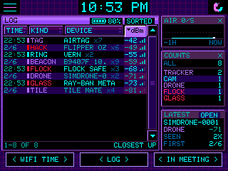
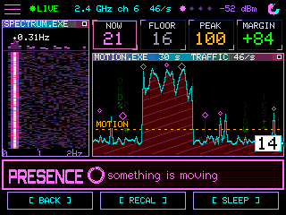

# MuleSkin-CYD

> Surveillance-device detector for the ESP32-2432S028R ("Cheap Yellow Display").

MuleSkin-CYD sniffs the 2.4 GHz airwaves for known wireless signatures
of Flock Safety cameras, Axon body cameras, recording glasses, card
skimmers, AirTags, drones, proximity beacons and pentest hardware. It runs
standalone on a bare CYD board — no PC, no extras, just plug it into USB.

The UI is a neon radar: the hooded-MuleSkin artwork on the splash, a
sweeping radar scope behind the main screen, full-screen ALERT cards, and
headlines in Orbitron.

> **A fork of [SquachWatch-CYD](https://github.com/skizzophrenic/SquachWatch-CYD)
> by [skizzophrenic](https://github.com/skizzophrenic).** The detection engine,
> the board ports and most of what follows are their work; this fork rebrands
> it as MuleSkin, reworks the look and the main screen, and leaves out the
> board-to-board squad mesh. Like the original, it is GPL-3.0.

<p align="center">
  
</p>

## What it detects

| Type | What | How |
|---|---|---|
| `FLOCK` | Flock Safety ALPR cameras | 29 WiFi OUI prefixes + BLE name + company ID `0x09C8` (the Penguin battery packs' radio; Medium unless the name agrees) |
| `AXON` | Axon body cameras, TASERs, LE equipment | 3 WiFi OUI + SSID prefixes `AB2-`/`AB3-`/`AB4-`/`AXON-` |
| `META` | Camera glasses — Ray-Ban Meta, Snap Spectacles | BLE service UUID `0xFD5F` + Meta / Luxottica / Snap company IDs |
| `SKIMMER` | Bluetooth card skimmers (HC-05/06/03, RN42, BT04-A; HC-08 and FCD_1608 by rules set 4) | BT Classic name match + SPP UUID `0x1101` + 3 OUI |
| `RAVEN` | Raven gunshot detector | Service UUIDs `0x3100`–`0x3500` |
| `AIRTAG` | Apple AirTag / Find My trackers | Company ID `0x004C` + Find My payload check. The Find My beacon itself (`4C 00 12 19`) is what a tag sends only when it is **away from its owner** -- HIGH, "AWAY FROM OWNER" on the alert and in the push, and the only AirTag that counts toward WITH YOU; any other 30-byte Apple advert (AirPods pairing too) is LOW, logged and never alerted |
| `DRONE` | Remote ID drones, and DJI / Tello drones that send none over WiFi | Service UUID `0xFFFA`, then the ASTM F3411 message **decoded** — aircraft position, altitude, serial, and the operator's location; DJI's 10 registered OUI and the Tello's `TELLO-`/`RMTT-` network (rules set 4) |
| `ALPR` | Motorola Solutions / Genetec plate readers | 6 WiFi OUI |
| `CAMERA` | Generic / covert IP cameras | 17 WiFi OUI (Wyze, Amazon, Tuya, Verkada, Avigilon, Axis, …) |
| `SAMSUNG_TAG` | Samsung Galaxy SmartTag / SmartTag+ | BLE service UUID / service data `0xFD5A`; its tag state (bits 5-7 of the first byte) 2 or 3 is lost / long lost -- **away from its owner**, HIGH, `Away-Owner` -- else MED |
| `GOOGLE_TAG` | Google Find My Device trackers (Chipolo, Pebblebee, Moto Tag), and any tracker on the DULT standard | Service data under `0xFEAA` with the tracker frame type `0x40`/`0x41` -- not the plain Eddystone beacons that share the UUID. `0x41` (Google's unwanted-tracking mode = DULT's separated state) is **away from its owner**, HIGH; `0x40` MED. And DULT's own `0xFCB2` service data with the near-owner bit clear: a separated tracker of any brand |
| `TILE` | Tile BLE trackers | BLE service UUID `0xFEED` / `0xFEEC` |
| `RING` | Ring doorbells / cameras | 15 WiFi OUI (Ring LLC's registered block + Amazon's) |
| `DEAUTH` | WiFi deauthentication floods | Rate-detected burst, not a signature: 12 from one sender in 3 s, or 6 sent to everyone |
| `EVILTWIN` | Rogue / spoofed access points | One SSID beaconing from two BSSIDs that disagree about encryption |
| `IBEACON` | Retail proximity beacons | Exact Apple header `4C 00 02 15` — **off by default**, see below |
| `MY ALERT` | WiFi networks whose names match your own patterns | Settings → MY ALERTS: up to eight names of your own, each with an optional label for the alert card. Plain text catches names that start with it; `*` stands for anything and `?` for one character (`veh*` catches `veh912`). At least two fixed characters. A PIN wipe clears the list (from upstream SquachWatch v1.45) |
| `HACKER` | Flipper Zero, Pwnagotchi, WiFi Pineapple, ESP deauthers, karma APs | Flipper's service UUIDs `0x3080`–`0x3083` (not its company ID or OUI, which are its BUSY Bar's); the Pwnagotchi's own beacon payload; `Pineapple_` and `pwned` SSIDs; and any access point answering to five network names in five minutes from one address (beacons and probe responses) -- a karma AP, `Karma-AP` |
| `LORAWAN` | A LoRaWAN operator's network in range (a utility's meters, city sensors, The Things Network) | LoRa boards only, while LORA listens on a LoRaWAN profile: the DevAddr prefix of a data frame, looked up in the LoRa Alliance NetID registry. One alert per operator, not per device |

### Confidence is per signature, not per type

Every hardware prefix in the firmware was checked against the IEEE registry
rather than against other detectors. Of 110 rows: **35 High, 26 Medium, 49
Low**.

That grading matters most on `FLOCK`, where exactly **one** of 32 prefixes is
registered to Flock Safety and the rest are the generic Liteon, Silicon Labs
and other parts they build on — real evidence, shared with plenty of other
gear. Espressif's blocks are not among them: every ESP32 has one, this board
included.
`ALERT FILTER` is a minimum-confidence gate, so setting it to High keeps a
passing ESP32 in the log without taking over the screen.

The audit also removed `00:0E:58`, which sat here for eleven releases
labelled "Vigilant" and is registered to **Sonos**. Every speaker in range
was being logged as a plate reader.

`IBEACON` ships switched off — not a judgement about importance, one about
volume. One shop can put more beacons in range than this device would
otherwise see all week. It is one tap away in `DETECTION FILTER`.

### New rules without a new release

The table above is what is built in. On top of it, a board with a saved WiFi
network fetches a **signed rule set** from flasher.oillie.cloud at every boot
check (`web-flasher/signatures.txt`): extra address prefixes and WiFi
network names, used only when the signature checks out. Rules only ever add:
a prefix the firmware already knows keeps its built-in meaning. The rule
set is how new signatures reach boards between releases; at the next
release they move into the firmware. Since v3.9.0 every rule of sets 2-4
is built in -- the body cams, ShotSpotter, the Neology and Kapsch plate
readers, Axis, Hanwha, Hikvision, Dahua, Uniview, Reolink, Amcrest and the
other camera makers, the camera setup hotspots (`davinci`, `HAP_`, `DAP-`),
the Tello drones and the HC-08 / FCD_1608 skimmer modules -- and set 6 is
empty.

## Hardware

- **ESP32-2432S028R** ("Cheap Yellow Display" / CYD) — about $15.
  Built-in 320×240 ILI9341 TFT, XPT2046 resistive touch, and an
  onboard microSD card slot.
- **Elecrow CrowPanel Advance 7.0** — experimental: an ESP32-S3 with an
  800×480 RGB panel and GT911 touch, via the `crowpanel7` build. It renders
  at 400×240 doubled, on purpose. See [board setup and testing](docs/CROWPANEL7.md).

That's it. No GPS, no extra modules. The CYD is the whole device. A small
speaker on its SPEAK connector is optional, and stays silent unless you
switch BUZZER on.

Other boards have builds of their own -- `platformio.ini` has one
`[env:...]` each, with what is and is not confirmed on it. The newest is the
**RockBase NM-CYD-C5** (`[env:nm-cyd-c5]`): the classic 2.8" CYD's glass on
an **ESP32-C5**, the first RISC-V chip here, with dual-band Wi-Fi 6, 16 MB of
flash and 8 MB of PSRAM. It runs the whole firmware and is on the web flasher
as a BETA; [docs/NM-CYD-C5.md](docs/NM-CYD-C5.md) has the esptool route and
every pin. Before it, the **Freenove ESP32-S3
Display 2.8"** (FNK0104B, `[env:freenove-s3]`): an S3 with capacitive touch, an
SDMMC card slot, a WS2812 status light and a battery connector. Pins in
[docs/PINOUT.md](docs/PINOUT.md).

Two more came over from upstream SquachWatch in v3.6.0, both BETA on the
flasher until they have run here:

- **Sunton ESP32-3248S035C** (`[env:cyd35c-fast]`): the 3.5" CYD with
  capacitive touch -- the resistive 3.5"'s ST7796 panel, and a GT911 on I2C
  (SDA 33, SCL 32, reset 25, INT 21), the 3.2" capacitive's touch chip.
  Contributed upstream by VV-B0Y (PR #24).
- **Freenove ESP32-S3 Display 4.0"** (FNK0104S, `[env:freenove-s3-40]`): the
  Freenove 2.8"'s board with a 320×480 ST7796; touch, card, light and
  battery on the same pins. Its 480×320 frame lives in PSRAM. Contributed
  upstream by T0x0pl4sm4 (PR #51). If the picture tears or speckles, build
  with `-DSPI_FREQUENCY=40000000`.
- **Freenove ESP32-S3 Display 3.5"** (FNK0104N, `[env:freenove-s3-35]`,
  from upstream v1.34.0): the Freenove 2.8"'s board with a 320×480 ST77922 on
  a four-lane QSPI bus TFT_eSPI cannot drive, and touch inside the same chip.
  `st77922_*.cpp` own the bus, the panel and the touch; the frame (480×320,
  in PSRAM) goes out from the loop, changed bands only, rotated on the way.
  Its SD (SDMMC 2-7), LED (40), battery (8) and backlight (41) pins differ.
- **LilyGo T-Deck Plus** (`[env:tdeck-plus]`, from upstream v1.36.0): an S3
  handheld with a 2.8" ST7789, GT911 touch, an SD slot on the display's bus,
  a battery, a GPS (WARDRIVE to the card) and a real keyboard, which types
  into the WiFi password and the PIN pad. Its backlight is a 16-step chip
  that counts pulses, so it is stepped rather than PWM'd; landscape only,
  keyboard down. The trackball, the LoRa radio and the speaker sit this one
  out.
- **M5Stack StickS3** (`[env:sticks3]`, BETA) and **Cardputer ADV**
  (`[env:cardputer-adv]`, experimental), from upstream v1.31.0 and
  v1.42-v1.43: 240x135 screens with no touch. The keys drive a cursor through
  each screen's buttons, and the one it is on lights up whole -- on the
  StickS3 a front click steps, a front hold selects, a side click is BACK and
  a side hold goes home; on the Cardputer the arrows or TAB step, ENTER or
  space presses, ESC is BACK (held 3 s, home) and letters are hotkeys. The
  screens have small layouts of their own: a compact alert card, a
  one-line-a-row LOG, tighter lists, a paged DIAGNOSTICS and MORE INFO, a
  shorter PIN pad. The Cardputer types on its keyboard, has its SD slot and
  wardrives with a Grove GPS; a wiggle wakes either one's dark screen. The
  Cardputer's optional EXT SCREEN panel is not ported. Controls in
  [docs/SMALL-BOARDS.md](docs/SMALL-BOARDS.md).
- **Marauder V8** (`[env:marauder-v8]`, from upstream v1.36.0):
  justcallmekoko's ESP32-C5 board -- the NM-CYD-C5's SPI bus with an
  ILI9341 at 40 MHz, resistive touch, an SD slot, a MAX17048 battery gauge
  (BATTERY on the SYSTEM page, "+" while charging), a GPS on GPIO14 (the
  CYD GPS code: WARDRIVE to a WiGLE file on the card), its activity LED as
  the status light, and 5 GHz scanning. Its own 8 MB partition table.

## Web Flash

No build tools, no IDE, no cloning anything — flash a board straight
from your browser:

**[https://flasher.oillie.cloud/](https://flasher.oillie.cloud/)**

Works in Firefox, Chrome, Edge, or Brave on desktop. Pick your board (2.8" CYD,
AWOK 2.4", RL Phantom 2.4", Freenove 3.2", or in beta the 3.5", the LilyGo
T-Watch S3, the Freenove ESP32-S3 2.8", the Elecrow CrowPanel 7" and the
RockBase NM-CYD-C5), plug in,
click Connect & Install, done. A T-Watch has its clock set for it once the install
finishes.

The same page talks to a plugged-in board over the cable, and says which
one it is as it connects -- its name, its Bluetooth name and its firmware:

- **Set Time & Zone** sends this computer's clock and time zone.
- **Back up / Restore settings** keeps your settings across an install that
  erases the board.
- **Ignored devices** lists the devices the board never alerts for, and
  removes or adds one.
- **Away days** lists the trackers the board has heard on days away from
  home (three makes NEAR YOU ON N DAYS), the home network it goes by and how
  many of its routers it has learned -- and removes one, or all.
- **Push options** picks exactly which types PUSH ALERTS sends, and quiet
  hours for PUSH AT NIGHT of their own.
- **Download log** saves every detection the board has kept as a
  spreadsheet, and charts it on the page: by type, by hour of the day, and
  the devices seen on more than one day. **Crash report** reads what it kept
  about its last crash.
- The log's CSV has each sighting's confidence, an **away** column (a
  tracker that said it was away from its owner) and **away_days** (the days
  the board has heard it away from home), and the charts can show only those.
- As it connects, the page says which board it is and when this browser last
  backed it up -- and nudges when that was never, or over a month ago.
- **Self-test** checks the board's parts -- memory, touch, both radios, the
  black box, SD card, settings, clock, WiFi, update keys, rules -- and lists
  anything that needs a look.
- **Live view** shows what the board is detecting right now, live -- trackers
  away from their owner first, in red -- and ignores a device from its row.
- **What the alerts mean** (`/alerts/`, linked under the legend): WITH YOU,
  NEAR YOU ON N DAYS, AWAY FROM OWNER, fake-tag spam, karma/evil-twin WiFi,
  confidence -- and what to do about each.
- The page's footer shows the site's last redeploy: the release, and where
  it stopped if it failed.

Every release is also on [GitHub Releases](https://github.com/muleskin/MuleSkin-CYD/releases)
with the bins for every board attached, and the page keeps the previous
releases in a version picker.

## Build

Three steps:

1. Install [PlatformIO](https://platformio.org/) (CLI or VS Code extension).
2. Clone the repo:
   ```sh
   git clone https://github.com/muleskin/MuleSkin-CYD
   cd MuleSkin-CYD
   ```
3. Build and flash:
   ```sh
   pio run -t upload
   ```
   For a board that is not the default three, name its build, e.g.
   `pio run -e freenove-s3 -t upload`.

The first build pulls the TFT_eSPI, XPT2046, and NimBLE-Arduino
libraries; after that it's incremental.

A full beginner-friendly walkthrough is in [docs/BUILD.md](docs/BUILD.md).

## Usage

<p align="center">
  
</p>

1. Plug the CYD into USB-C.
2. The splash runs for about three seconds: the MuleSkin artwork, ears
   twitching, with the release under the wordmark and the build's own
   version on the INITIALIZING line (from `git describe`, so a working-tree
   build says so).
3. The main screen appears: the radar sweeping, the time at the top centre
   once the clock is set, and live per-type counters in alphabetical order.
   Everything heard in the last minute is a blip on the scope in its type's
   colour -- nearer the centre the stronger its signal, lighting up as the
   arm passes and fading a minute after it was last heard. (The bearing is
   only a fixed place per device: the board can't tell direction.) Tap a
   blip for that device's panel -- WATCH, IGNORE, HUNT or what it is.
   Rather have text? **Settings → TERMINAL MODE** puts a sortable log and
   a few windows of numbers in the radar's place (see
   [TERMINAL MODE](#terminal-mode-brought-over-from-upstream-squachwatch-v143-v149)).
4. The soft buttons at the bottom:
   - **`< WIFI TIME >`** — join your saved WiFi network just long enough to
     set the clock (see [The clock](#the-clock)).
   - **`< LOG >`** — open the rolling 200-entry detection log; tap it again
     to return to the main screen. On the LOG screen a second button,
     **`[ CLR ]`**, wipes the log and returns.
   - **`< IN MEETING >`** — a red do-not-disturb sign, **IN A MEETING** in
     big white letters, with BACK to return. It never dims, no alert takes
     it over, and the status light and buzzers stay quiet; detection keeps
     running and logging behind it. Tap the sign for a timer -- **BACK IN 15,
     30 or 60 MIN** -- and it takes itself down when the time is up.
5. When something is detected, the device **flashes a full-screen ALERT**:
   a header strip in the detection's own colour with the type in the
   headline face, a data plate with the vendor, the device's own name where
   it broadcasts one, its MAC and a signal meter, and a gauge showing what
   was found with the instrument grid over it. Tap anywhere to dismiss
   early, or it clears itself after 60 seconds.
6. **A tracker travelling with you** gets its own alert. An AirTag, Tile,
   SmartTag or Find My Device tag that has stayed in range for twenty
   minutes while the devices around you kept changing -- you are moving and
   it is not being left behind -- raises the alert card with **WITH YOU
   N MIN** across the top, once per tag. A tag near its owner changes its
   address every quarter of an hour, so it never gets that far; one planted
   on you keeps its address for about a day. When it does change it while
   in range -- one tag of that kind goes quiet and one new one turns up
   within 90 seconds at much the same signal, and no other tag fits --
   the new address carries on its minutes, and its days for NEAR YOU ON N
   DAYS. Ignore a tag to stop it -- an IGNORE or SNOOZE moves to its new
   address with it, the same way, and so does a HUNT on it ("HUNT FOLLOWS",
   readings kept).

If a microSD card is present, every detection is also appended to
`MuleSkin-<day>.log` (CSV: `ts,type,rssi,mac,channel,vendor,ssid`).

### The clock

There is no GPS, and the board never joins a network to scan. It joins one
to tell the time: **`< WIFI TIME >`** on the main screen joins your saved
network (the one marked USE, or the strongest saved one in range), asks a time
server, and lets go, pausing detection only while the radio is busy; with no
network saved it opens WIFI NETWORKS to add one. The boot-time update check
and UPDATE OVER WIFI set the clock the same way while the radio is up anyway.
**AUTO TIME** (on the SYSTEM page, on by default) keeps it right on its own:
with a network saved, the board rejoins it once a day from the main screen --
and once a couple of minutes after a boot that didn't set the clock -- for the
few seconds a time server takes. Once the time is real it shows at the top
centre of the main screen, 12-hour with AM/PM. Tap it for **TODAY**: a bar
for every hour since midnight, the types seen most, and the first and last
sighting -- counted from the black box, so a restart doesn't lose the morning. The zone is yours to pick, and there are three ways: the web
flasher's **Set Time & Zone** button sends this computer's clock and zone
down the same cable right after flashing; the first time the clock is set
with no zone chosen, a card on the main screen asks, with the live time in
the zone it shows so you can see when it's right; and **TIME ZONE** on the
SYSTEM page changes it later. Daylight saving takes care of itself. Without
a saved network the clock can still be set over serial with a `TIME <epoch>`
line at 2,000,000 baud, and `ZONE US EASTERN` sets the zone the same way.
Until the clock is set, timestamps count from boot. The board keeps a
note of the time in flash every ten minutes, and a cold boot with no clock
starts from that note: not the right time, since nobody knows how long the
power was off, but never earlier than the note, which keeps the day count
honest. Such a clock is used for the date only; the LOG times, the night
tag and the hour lines wait for a real answer.

Once it is set, the LOG shows the real time of each catch (or the date, for
one from another day), and the alert card says **AT NIGHT** for anything
caught between eleven and five. **NIGHT DIM** on the APPEARANCE page
(10PM-6AM, 11PM-7AM or 12AM-7AM) runs the screen at a quarter of its
brightness through those hours, full again for half a minute after a touch
or an alert; scanning carries on at full rate. **NIGHT POWER** beside it
saves more through the same hours (11 PM-5 AM with NIGHT DIM off): **DARK**
turns the screen off half a minute after the last touch (a tap wakes it
and is not taken as a press; an alert lights it), and **DARK+WIFI** also
rests the WiFi sniffer 25 s of every 30 while it is dark on the main
screen. Bluetooth never rests, so a tracker is still caught at 3 AM. The
watch offers DARK only: its RADIOS setting already cycles its radios.

### Detection pauses while it's on WiFi

Nothing is detected while the board is joined to a network, attacks
included. To stay associated the radio has to sit on the access point's
channel, so WIFI TIME, AUTO TIME, the boot-time update check and UPDATE OVER WIFI turn
the WiFi sniffer off first (no DEAUTH, EVIL TWIN, pentest-gear or other WiFi
catches) and stop BLE scanning too (no trackers). The board never stays
connected: WIFI TIME gives the join 20 seconds and the time server about 6,
then lets go, and detection resumes the moment the radio is free, so the
blind spot is a few seconds and at most about 26. An update over WiFi is
blind for as long as the download and flash take. While the main screen is
up, an amber **PAUSED** pill in the title bar shows when scanning is off.

One consequence: an evil twin or a deauth flood aimed at the board's own
join isn't flagged while it happens. A flood still shows up as a join that
fails ("Could not join" on the WIFI TIME screen), and it's caught as soon as
scanning resumes if it's still going.

## The status light

The RGB LED on the back of the 2.8" CYD (on the front of the RL Phantom, and
a WS2812 on the Freenove ESP32-S3 2.8")
tells you what the screen is doing without the screen. A slow breathe in the
theme's colour when nothing is happening; three flashes and a hold in the
detection's own colour when something is, for as long as the alert card is
up; cyan while an update downloads and green or red for how it went. It goes
dark on the lock screen and through a wipe, so a duress restart looks like any
other restart from the back too.

**Settings → APPEARANCE → STATUS LIGHT**: the master switch, alerts on or
off, idle breathe or solid or off, an idle colour that follows the theme, the
background, or one of nine fixed colours, brightness in seven steps, and a
TEST row that plays an alert and the idle in four seconds. Boards whose LED pins
have not been checked (the AWOK and the 3.5") compile it out and say so on
that screen.

## Sound and push alerts

**BUZZER** (Settings, off by default) chirps once for a device the board has
never logged before (not at night or with the screen dimmed), and for every
WITH YOU, whenever it comes. The CrowPanel 7 has a buzzer; on the 2.8" CYD, plug a small 8 ohm
speaker into the two-pin SPEAK connector.

### Push alerts

**PUSH ALERTS** (Settings, every board, off by default) sends each alert to
your phone as a real push notification -- lock screen, phone in your pocket,
no page left open -- through the free **ntfy** app on iPhone or Android. The
board joins one of its saved WiFi networks for a couple of seconds to send it
-- home, work, or your phone's Personal Hotspot (on an iPhone, turn on
*Maximize Compatibility*: the board needs 2.4 GHz) -- and lets go.

Set it up from the flasher page, **SET UP PUSH ALERTS**: it makes a long
random topic, you subscribe to it in the ntfy app, and it sends the setup to
the board over the cable and has it post a test. Once it is on, three more
rows tune it:

- **PUSH WHAT** -- WITH YOU only; **IMPORTANT** (the default: WITH YOU plus
  Flock, Axon, plate readers, Raven, cameras, camera glasses, skimmers, WiFi
  attacks and attack tools -- Flipper, Pineapple, karma APs -- not every
  passing AirTag); ALL; or **CHOSEN**, the types
  ticked in the web flasher's PUSH OPTIONS.
- **PUSH AT NIGHT** -- through NIGHT DIM's hours (11 PM-5 AM without them),
  or quiet hours of its own set in PUSH OPTIONS: WITH YOU only (the
  default), or as set.
- **DAILY SUMMARY** -- one quiet push at 8 PM: the day's count, its top three
  types, the first and last sighting, how many were pushed and held back, and
  the board's firmware version and settings store -- a board left behind
  shows without being plugged in -- and, the day a new signed rules set
  arrives, which one.

Alerts go as they happen: a WITH YOU at once and loud, the rest a few
seconds after the first, so a burst is one join rather than ten; joins are at
least twenty seconds apart, and each costs detection a couple of seconds of
blindness. With no saved network in range they wait -- the eight newest, for
up to half an hour, with an amber **PUSH n** pill in the title bar -- and go
at the next chance, with the time they happened. If the best network in range
will not take the board, it tries the next one. Each device keeps one
notification: on Android (and ntfy's web app) a camera that keeps alerting
replaces its own notification rather than stacking up -- the iPhone app, as of
ntfy 1.7, still shows each one.

One push per device an hour: a camera you sit beside all afternoon, or a
tracker drifting in and out of range, is one notification, not forty. And at
most 30 a day: past that the board says so once and keeps the rest, and the
evening summary counts them. WITH YOU always goes, either way.

- **PUSH AT HOME** -- while the board can see your home network (the one
  marked USE in WIFI NETWORKS): AS SET (the default), IMPORTANT at most, or
  WITH YOU only. Only ever quieter: a faked beacon of your network can hush
  routine pushes, never add any.
- **Ignore** on a notification adds that device to the board's ignore list
  the next time the board joins WiFi -- for your own AirTag, your own
  doorbell; **Snooze 1 day** quiets it for a day (or until a restart) -- for
  a neighbour's camera. Either way the board answers with a quiet "ignored"
  or "snoozed" push once it has done it, with an **Undo** button of its own.
  **Pause 2 h** holds that board's ordinary pushes for two hours -- a
  meeting, a drive -- with WITH YOU still coming through, and an Undo too.
  On your own ntfy server it needs a one-time step,
  [deploy/README.md](deploy/README.md).
- **Near you on several days**: a tracker away from its owner seen on three
  or more different days gets the alert -- "NEAR YOU ON N DAYS" -- and a
  push, once a day each. Only days heard **away from home** count (home: the
  WiFi network marked USE, heard in the last few minutes), so a neighbour's
  tag beside a board that never leaves the house never raises it; a tag
  following you is heard in different places. With no home network set,
  every day counts, and one Ignore settles a tag you know, on every board.
  Home is recognised by its routers, not just its name: each time the board
  joins the USE network it learns the access point it went through (up to
  four; a router's other band counts as the same box), so a hotspot of the
  same name elsewhere -- "xfinitywifi" -- is not home. The LOG shows a
  tracker's away days beside it ("2d away", in yellow) before it gets to
  three, and the first minutes after a restart, before home has been heard,
  count as neither.
- **What to do, one scan away**: a WITH YOU, NEAR YOU ON N DAYS or AWAY FROM
  OWNER alert shows a QR code (in place of the gauge) to that alert's part of
  [flasher.oillie.cloud/alerts](https://flasher.oillie.cloud/alerts/).
- **Several boards on one topic**: an Ignore or Snooze pressed on any board's
  alert is applied by all of them -- your own AirTag is yours everywhere --
  but only the board that sent the alert says so back. A device ignored (or
  un-ignored) on one board's own screen, or over its cable, is passed to the
  others the same way. Give each a **board name** in SET UP PUSH ALERTS
  ("Car", "Desk") so you can tell their pushes apart.

A server that says "too many" (HTTP 429) is not asked again two minutes
later: the board waits as long as it says, or 15 minutes, then 30, 60 and
120. With your own ntfy server, [deploy/README.md](deploy/README.md) also has
a check that pushes "quiet" when a board has sent nothing for a day.

The self-test's **push alerts** line and DIAGNOSTICS' **PUSH** row say how
many went today, how many the limits held back, and how the last one went --
sent, or why not (WiFi did not join, the server refused the token, a rate
limit, the IGNORE topic failing) -- so a push that quietly stops arriving
shows on the board too. DIAGNOSTICS' **HOME** row says whether the board
hears the home network right now, and the 8 PM summary ends with the day's
pushed and held-back counts.

It uses the public ntfy.sh unless told otherwise: nothing to install, and
the topic is the password. For alerts that stay on your own server, behind
an account, run ntfy there -- [deploy/README.md](deploy/README.md) has the
setup, including Web Push for an iPhone (the ntfy web app on the home screen),
which avoids the daily limit ntfy.sh puts on relaying a self-hosted server's
alerts to the iPhone app. Either way the board posts in plain HTTP; TLS needs more memory than
it has.

## Updates

### Knowing there is an update

Nothing installs on its own unless you ask it to. At boot, a board with a
saved WiFi network joins it for about a second, asks flasher.oillie.cloud for
the latest version of its own build, and lets go again, all before Bluetooth
starts; **UPDATE CHECK** on the SYSTEM page turns that off. When there is a
newer one, the SYSTEM row reads UPDATE, and UPDATE FIRMWARE names the version
until you install it.

**AUTO UPDATE** on the SYSTEM page (off by default) installs it for you, at
night: during NIGHT DIM's hours (1 to 5 AM without them), from the main
screen, after ten minutes untouched and unlocked. It shows a 30 second
countdown with SKIP first, then joins the saved WiFi, installs, checks and
restarts; anything that fails leaves the old version running. The daily AUTO
TIME join checks for a new release too, so a board that is never restarted
still hears about one.

It has two speeds. **AFTER 3 DAYS** waits three days from when that board
first heard of the release; **EARLY** goes the first night. Set the board you
test on to EARLY and the rest to AFTER 3 DAYS: a release that turns out bad
shows itself on the test board, and once it is pulled from the site the
others never install it.

**UPDATE FIRMWARE** installs it three ways: over WiFi from the site, over
USB from the web flasher, or over **Bluetooth** from a browser in range --
UPDATE OVER BLUETOOTH on the board, then
[flasher.oillie.cloud/update](https://flasher.oillie.cloud/update/) on a
computer or phone with Web Bluetooth (Chrome, Edge; Bluefy on an iPhone),
and the six-digit code the board shows. Every image is checked against the
release key before it is installed, whichever way it came.

### The bigger settings store (v3.2.0): one USB install

Up to v3.1.8 the board kept its settings in 20 KB of flash, and a board that
had been in use for a while could fill it. A full store is erased whole at
boot -- WiFi networks, push alerts, the touch calibration, everything. From
v3.2.0 the store is 128 KB and somewhere else in flash, and that takes a new
partition table, which only a **USB install** can write. An update over WiFi
or Bluetooth still works but keeps the old 20 KB store; the self-test's
"settings store" line says which one a board has.

A board still on the small store says so: a card on the main screen on its
first three boots, and MuleSkin mentions it now and then after that.

So, once per board: plug it in, **Connect & Install** from the web flasher
**without** ticking "Erase device". The first boot moves every setting into
the new store by itself and erases the old copy. If you do erase (or to be
safe anyway), **Back up settings** first and **Restore settings** after.

**WIFI NETWORKS** on the SYSTEM page is where the board keeps the networks it
knows: up to six, with USE marking the one it tries first. ADD picks one from
a scan and takes the password on the board's keyboard; it is not checked by
joining, since joining means giving Bluetooth up until a restart, but at the
next boot check, and each row then says how that went: joined, wrong
password, or not found. At boot the board scans, joins the USE network if it
is there and otherwise the strongest saved one that is, so home and work both
just work. The update flow does the same, and only shows its own list when
none of the saved networks is in range. REMOVE takes one off the list.

## Smaller things

- **Arrows on NEARBY.** Each device shows a green up-arrow when it has come
  closer since its last reading and a red down-arrow when it has moved away;
  under four dB of change shows nothing, which is what a still device does.
- **First of its kind.** The first time this board ever catches a type, the
  card says so.
- **SNOOZE on an alert.** Quiets that one device for 10 minutes; tap again
  for 30 minutes, 1 hour, 4 hours or MORNING -- until NIGHT DIM's hours
  end, or 7 AM without them; offered once the clock is set (the button
  shows the pick, which locks in three seconds after the last tap). A restart ends it too. It is still
  scanned, counted and logged; only the alert stops. IGNORE is the same
  thing kept for good.
- **RING** (the S3 and C5 boards; from upstream SquachWatch v1.48). A RING
  button on an AirTag, Samsung, Google or Tile alert, and RING IT on a
  tracker's LOG panel: the board pauses its scan, connects to the tracker
  and asks it to beep (AirTag's own sound command, then DULT, then Find My),
  and says how it went. Trackers only answer while they are away from their
  owner -- that is the anti-stalking design -- so "it said no" usually means
  its owner is near. Not on the CYDs (no room for Bluetooth's connecting
  role) or the 240x135 boards' alert card. Console: RING rings the tracker
  heard most recently. Idea: JBoHack and Hedge; command bytes as AirGuard
  (seemoo-lab) documents them.

### Brought over from upstream SquachWatch (v1.31-v1.36)

MuleSkin forked from SquachWatch-CYD v1.28.0. These later upstream changes
were ported (v3.5.0), adapted where the two have grown apart:

- **Update failures that say why** (v1.33): a sign-in page, a network that
  blocks the site, an https-only redirect, a slow or failing site, or no
  connection -- each its own sentence, with the detail after it ("(HTTP
  403)"). Fetches retry up to three times. When the router's name lookup
  fails, the board reaches flasher.oillie.cloud by the last address the name
  had (upstream uses GitHub Pages' fixed addresses; this site is our own).
- **About 70 KB of flash back** (v1.33): C++ exceptions off everywhere (no
  catch exists in the firmware), and fixed colours as constants.
- **5 GHz on the NM-CYD-C5** (v1.31, PR #27 by quietradio): a short 5 GHz
  slice after every 2.4 GHz sweep, WIFI BANDS in Settings, "5G CH 149" on
  the alert, and the black box at last (it sat inside the C5's app slot).
- **Raven** (v1.36, #41): only its five service numbers match; the old range
  called an NVIDIA Shield a gunshot detector.
- **A guessed clock stays a guess** across a restart (v1.36), and the away
  days count only on a trusted clock.
- **POCKET MODE** (v1.34): the BOOT button puts the screen out and only the
  button brings it back; an alert lights it for its card, then it is dark
  again.
- **T-Deck Plus trackball** (v1.46, v1.49): the ball moves a cursor through
  each screen's buttons beside the touch panel (down/right the next, up/left
  the one before), a press presses there, and a touch puts the cursor out.
  Held 2 s it is POCKET MODE; a press wakes it. Console: TBALL. It shares the
  small boards' cursor (v1.42): the whole button lights up, lists scroll
  under it, the first roll or press with it hidden only shows it, and
  Backspace off a text screen is BACK.
- **BRIGHT** has real - and + buttons (v1.35).
- **SD log by date** (v1.36, PR #46 by jotra7): /MuleSkin-YYYYMMDD.log with
  the real time in each row (/MuleSkin-nodate.log until the clock is
  trusted). The security wipe now really removes them: the rename had left
  it matching nothing.
- **GPS on the CYD** (v1.36, PR #46 by jotra7): `cyd-gps` and
  `cyd-ili9341-gps` builds for an ATGM336H on GPIO35 -- a position on each SD
  row and on the alert, the clock without WiFi, WARDRIVE to a WiGLE file on
  the card, the fix in DIAGNOSTICS. Not on the flasher until tested on
  hardware. (Upstream's emulator GPS replay and main-screen GPS label were
  not brought over.)

### The small boards, brought over from upstream SquachWatch (v1.42-v1.43)

The StickS3 and the Cardputer ADV got upstream's reworked key cursor, laid
out for MuleSkin's own screens ([docs/SMALL-BOARDS.md](docs/SMALL-BOARDS.md)):

- **One button scheme.** StickS3: front click next, front hold select, side
  click BACK, side hold HOME. Cardputer: arrows move, ENTER selects, ESC is
  BACK, ESC held 3 s is HOME. BACK on the main screen opens the menu.
- **The whole button lights up** (a sliding purple-cyan-pink gradient) in
  place of the amber brackets. BACK always lands on the screen's own BACK or
  CANCEL, found with its own hit test, never on a guessed spot.
- **Real stops on every screen**, found by sweeping each screen's hit test:
  the color check, UPDATE, WIFI NETWORKS and its scan, MY ALERTS, the
  ignore list, HUNT, IN MEETING, TODAY, WIFI TIME, the DEX tiles, SYSTEM
  PROPERTIES, AUTO UPDATE, the time zone card. Half-hidden rows are skipped.
- **Lists scroll under the cursor and loop**: no paging arrows.
- **Cardputer**: the WiFi password, MY ALERTS' pattern and label, and the PIN
  type on the keyboard (TAB shows a password); a letter presses the button
  that starts with it, plus W / L / M / T / S from the main screen
  ([docs/CARDPUTER-HOTKEYS.md](docs/CARDPUTER-HOTKEYS.md));
  the SD slot; an M5 Unit GPS on the Grove port for WARDRIVE (the CYD GPS
  code, 115200 first).
- **StickS3**: the BMI270 wakes a dark screen on a wiggle or a shake (the
  Cardputer's too); POWER SAVER on by default, dark after a minute. No
  SECURITY, WIFI NETWORKS or UPDATE OVER WIFI: nothing can be typed on two
  buttons, and a PIN saved earlier never locks it.
- CALIBRATE TOUCH is gone from both; CHECK COLORS and CHARGE MODE fit 135
  rows; prompts say PRESS, not TAP; the scrollbar fades when the list stops.
- Dev builds `sticks3-dev` and `cardputer-adv-dev` take KEY, TYPE and SHOT on
  the console; `tools/shot.py`, `goto.py` and `sheet.py` drive them
  ([docs/SMALL-BOARDS-DEV.md](docs/SMALL-BOARDS-DEV.md)).

Not brought over: FOB MODE and knocking or shaking the mascot (upstream's
are Squachy's), the EXT SCREEN, the speaker tones and WARDRIVE SOUND (no
sound layer for the boards' codecs here), gps-status.log, and the SquachMesh,
SCAN and desk screens' stops.

### Boards brought over from upstream SquachWatch (v1.41-v1.47), build-it-yourself

Not on the flasher until they have been run on a board here
(`pio run -e <env> -t upload`):

- `waveshare-c5-28` -- the Waveshare ESP32-C5-Touch-LCD-2.8 (PR #62 by
  bobsdinner-cell): 2.4 + 5 GHz, CST3530 touch, the panel's reset and
  backlight behind a CH32V003 helper on I2C. See docs/WAVESHARE-C5-28.md.
- `freenove-s3-gps` and `freenove-s3-35-gps` -- the Freenove S3 2.8" and 3.5"
  with a GPS module on the UART port's RXD (GPIO44): positions on SD rows and
  alerts, the clock from GPS, WARDRIVE to the SD_MMC card.
- `rlphantom-r-alt` -- the RL Phantom 2.4" resistive panel batch that shows a
  noise band and mirrored text on `rlphantom-r` (#88): the ILI9341_2 init and
  inversion on.
- `tab5` (BETA, upstream v1.47) -- the M5Stack Tab5: an ESP32-P4 with a 5"
  1280x720 touch screen (the app draws 640x360, doubled) and no radio of its
  own. WiFi and Bluetooth come from the ESP32-C6 beside it over ESP-Hosted,
  running upstream's sniff extension (`tools/tab5-c6/`); on first boot the
  app offers to write that firmware to the C6 itself. No SD card, WiFi
  updates, WIFI TIME or PUSH ALERTS on it yet, and no HUMAN SENSING. Never
  run on a board here. See docs/TAB5.md.

### TERMINAL MODE, brought over from upstream SquachWatch (v1.43-v1.49)

<p align="center">
  
</p>

**Settings → TERMINAL MODE** swaps the radar for a desktop of text windows,
for when you just want the data:

- **LOG**, one line per device: time, kind, name (through PRIVACY MODE, or
  a regular's name), how many times it came back (x5), signal bars and dBm.
  Drag it to scroll (or use the arrows and the track); scrolled up it says
  PAUSED and a **NOW / N NEW** pill takes you back to the newest.
- **Sort it**: tap TIME, KIND, DEVICE or dBm in the heading strip; tap again
  to flip it. TIME, newest at the bottom, is the live log; any other order
  says SORTED and names itself at the foot (CLOSEST UP, A-Z ...).
- **Tap a line** to pick it, **tap it again** (or tap LATEST / DETAILS) for
  the LOG screen's WATCH / HUNT / INFO / IGNORE panel; closing the panel
  comes back here.
- **AIR** (the busiest second of each of the last sixty minutes), **COUNTS**
  (the log's devices by kind, busiest first, folded like the counter row)
  and **LATEST**, down the right on a landscape screen and under the LOG on
  a portrait one. The StickS3 and the Cardputer (240x135) show the LOG alone.
- **The battery in the LOG's title bar** on the boards that can read one
  (T-Watch, T-Deck Plus, Freenove S3, Marauder V8): four segments and the
  percent, CHG on the cable where the board can tell, red under 20%.
- **Bigger text on the 3.5" and the 7"** (font 2 in taller rows).
- **It rests**: 3 s untouched it redraws four times a second, after 30 s
  twice, with the CPU at 80 MHz (not on the CrowPanel 7, whose panel the CPU
  feeds). The radios still get their turn every 20 ms; a touch, a key, the
  ball or a new catch wakes it at once.
- **The key cursor stops on it** (StickS3, Cardputer, the T-Deck's ball):
  the three buttons, the clock, the menu and the watch pill, then each
  heading, each row, the scroll arrows and LATEST, each lit whole.

The clock (TODAY), the menu, the title-bar pills and the bottom bar --
WIFI TIME / LOG / IN MEETING -- work as they do on the radar. A catch still
opens the full ALERT screen.

**Where it lives, and why.** Upstream reached it from a MODE button on the
main screen that stepped normal -> desk -> TERMINAL MODE. MuleSkin has no
desk (it was removed on purpose) and its third button is IN MEETING, so
there is no MODE button here: TERMINAL MODE takes over the **BORING MODE**
row in Settings, the way upstream turned BORING MODE into it. With the
mascot compiled out, BORING MODE had little left to do; it is the same
switch and the same NVS key (`boring`), so a board that had BORING MODE on
wakes up in TERMINAL MODE, and its other effects stay (a white status
light, the BLACK background on the other screens). One tap turns it on or
off; the confirm panel BORING MODE had is gone.

Not brought over: the MODE button and the desk's step to it, upstream's
StickS3-only TERMINAL MODE row (here the row is on every board), the boot
screen's wave and the first-boot lines (Squachy's), and the lava-lamp
battery on the main screen.

### HUMAN SENSING, brought over from upstream SquachWatch (v1.42-v1.49)

<p align="center">
  
</p>

**Settings → HUMAN SENSING** turns the board's own WiFi radio into a motion
sensor. It joins one of your saved networks (add one in **Settings → SYSTEM
→ WIFI NETWORKS** first; the same list WIFI TIME uses), pings the router
fifty times a second, and watches how the radio signal between them
changes (the channel state, CSI). A person moving through that path changes
it a lot; an empty room barely at all. It takes about 15 seconds to learn
the empty room, so keep still while it says PLEASE STAND BY.

- **SPECTRUM** (how fast the signal is changing, the newest on top and the
  last 11 seconds sliding down), the **NOW / FLOOR / PEAK / MARGIN** tiles,
  **MOTION** (the last 30 seconds against the line that counts as movement)
  and a banner: CLEAR, PRESENCE (someone moved in the last 15 seconds), or
  what the radio is doing (JOINING, and why a router said no).
- **RECAL** re-learns the empty room, **SLEEP** turns the screen off while
  sensing carries on (a tap or a key wakes it), **BACK** and the gear go to
  Settings, HOME to the radar.
- **Detection pauses while this screen is up**: there is one radio. The
  detector hands it over the way it does for WIFI TIME and gets it back the
  moment the screen goes. No saved network: the banner says ADD WIFI, and a
  tap on it opens WIFI NETWORKS.
- **The keys**: on the T-Deck, Backspace, R and S do the same, and O hands
  the radio straight back to the detector; on the StickS3 and the Cardputer
  (no button bar at 240x135) the cursor's one stop is the banner, where a
  press re-calibrates, and BACK or HOME leaves.
- **Movement is a detection**: `MOTION`, in the LOG, the counters (MOVE),
  IGNORE and SNOOZE, with a switch in DETECTION FILTER. Once per room (per
  network sensed through), and news again only after five still minutes. It
  goes to PUSH ALERTS ("MOTION in the room", with the motion score and how
  far the model trusts it) over the network sensing is already joined to,
  so the phone hears it while the room is watched; the status light flashes,
  and under SLEEP the screen lights for ten seconds. No alert card on this
  screen (PRESENCE already says it, and leaving would end the sensing).
  AUTO SNOOZE and the one-push-an-hour per device do not apply to it -- the
  five still minutes pace it -- but the daily push cap does. HUNT and WATCH
  say there is nothing to follow, and it is left out of the lifetime total
  the outfits count.
- **SENSE ARM** (Settings, under HUMAN SENSING): OFF, AT NIGHT (NIGHT DIM's
  hours, or the clock's night; never on an unset clock) or ALWAYS. Armed,
  sensing runs without its screen and **the detector is paused**, as it is
  with the screen open; the title bar says SENSING. From the main screen a
  movement raises the alert card. It lets go of the radio for HUNT, an
  update, WIFI TIME and WIFI NETWORKS, and picks up again after, and it
  needs a saved network. While it holds the radio AUTO TIME and AUTO UPDATE
  wait, so ALWAYS keeps the clock from being set over WiFi.
- **A refused board backs off** (20 s, then 40, up to 5 minutes) instead of
  getting itself blocked by the router. A board switched off on this screen
  comes back to it. PRIVACY MODE keeps the network's name and the router's
  address off the screen and the console.

**Three more pages, EXPERIMENTAL**, on the boards with the PSRAM and the
screen for them (the T-Deck Plus and the Freenove S3 2.8" and 3.5"): swipe,
tap the dots in the title bar, or press `,` and `.` on the T-Deck. The board
comes back to the same page after a restart. All three say EXPERIMENTAL at
the top: telling more than "something moved" from one router's signal is
hard, and they can be wrong. SENSING itself is not.

| Page | What it shows |
|---|---|
| **SCOPE** | A radar of the WiFi paths around the board (your router plus the three busiest other transmitters on its channel), each lighting up as something moves through it |
| **SNEAK** | A game: START RUN (ENTER on the T-Deck), hold still 5 s, then cross the room in 10 s without tripping the sensor. LEVEL (L) sets how still you have to be |
| **VITALS** | Sit still between the board and the router and it reads your breathing from the signal: breaths a minute, rhythm, depth, a waterfall, a breath loop and a lab log, and a heart rate only when it is sure. NEW SESSION (N) starts again. A toy, not a medical device |

**Which boards.** Every ESP32 and ESP32-S3 build (`extra_script.py` adds
`SENSE_CYD_APP`): the CYDs, the AWOK, the CrowPanel 7, the T-Watch, the
T-Deck Plus, the StickS3, the Cardputer ADV and the Freenove S3s. Not the
ESP32-C5 boards (NM-CYD-C5, Marauder V8, Waveshare C5): their radio's
channel-state calls differ, and upstream has not ported it there either.
It costs about 33 KB of flash; its buffers (about 8.5 KB, more for SCOPE
and VITALS) come from the heap only while the screen is open and go back
when it closes (upstream v1.44's fix), so a board that never opens it
scans with the heap it always had.

**Console**: `SENSE OPEN`, `SENSE CLOSE`,
`SENSE OPEN NOWIFI`, `SENSE NEXT` / `SENSE BACK` (the page), `SENSE SLEEP`
/ `SENSE WAKE`, and `SENSE <cmd>` for the engine (`SENSE HELP` lists them:
`cal`, `rates`, `stat`, `joins` ...). Upstream's `SENSE SHOT` is MuleSkin's
`SHOT` on the dev builds.

The motion model is ESP32Marauder's CsiMotionModel (MIT, justcallmekoko),
as upstream's is. Not brought over: upstream's Tab5 sensing (its ESP32-C6
radio, its own screens), the mascot's reactions on these screens
(MuleSkin's mascot is compiled out) and the web emulator's DEMO room.

### Fixes brought over from upstream SquachWatch (v1.41-v1.49)

- **Espressif's `BC:DD:C2` is no longer "Arlo"**: every ESP32 in that block
  read as a hidden camera. Arlo's three real blocks are in instead, and
  `tools/check_ouis.py --fetch` checks the whole table against the IEEE
  registry (the OUI audit workflow). The manual WiFi scan and the network
  picker now only listen (a passive sweep); `tools/check_emissions.sh` fails
  CI if one goes back to probing.
- **LoRa**: a MeshCore group text or LoRaWAN payload longer than its buffer
  is refused before it is decrypted -- one packet could overflow the stack.
- **Memory checks on the PSRAM boards** read internal RAM, so the low-memory
  seatbelt can actually trip there.
- **Alerts are announced once each, by sequence number**, not only if the
  loop reached the catch within 200 ms: a slow pass no longer loses the card,
  the sound and the push.
- **Updates**: an image with no version stamp is refused as older; a
  download clears the slot's old version record first, so SWITCH TO never
  boots a refused image; the manual WiFi check keeps trying for 90 s after
  the join; boards with PSRAM keep their frame through a download.
- **Detection log**: one lock for every writer (two rows could take one
  slot); a sweep, NEARBY or an update no longer makes the whole room re-alert
  afterwards; a scan deadline no longer re-arms 24.8 days later; a deauth
  flood spread across many spoofed senders (24 broadcast frames in 3 s) is
  caught.
- **PIN**: a first PIN turns LOCK AT BOOT on; the wipe also clears the
  regulars, the away days and the home routers.
- **Toasts** show their whole line; resistive touch rides over short read
  gaps instead of turning a drag into a tap.

## Project layout

```
MuleSkin-CYD/
├── platformio.ini
├── README.md
├── LICENSE
├── docs/
│   ├── FAQ.md                    (what it does, hardware, legality)
│   ├── DESIGN.md                 (the contract — single source of truth)
│   ├── BUILD.md                  (friendly walkthrough)
│   ├── PINOUT.md                 (CYD pin map)
│   ├── DETECTIONS.md             (per-signature provenance)
│   ├── MULESKINWARE-AESTHETIC.md   (CSS → RGB565 mapping)
│   ├── demo.gif                  (the artwork at the top of this file)
│   └── radar.gif                 (the radar background's source; see tools/)
├── include/
│   ├── state.h                   (DetectionType, Detection, Confidence)
│   ├── theme.h                   (palette, backgrounds, icons, chrome)
│   ├── signatures.h              (the tables and their lookups)
│   ├── detection.h
│   ├── remote_id.h               (ASTM F3411 decoder)
│   ├── clock.h                   (wall clock: NTP at the boot check, zones, the calendar)
│   ├── ignore_list.h             (per-device alert suppression)
│   ├── status_light.h            (the RGB LED and its rules)
│   ├── settings.h
│   ├── muleskin.h                 (the mascot -- switched off: MASCOT_SHOWN)
│   ├── bangers_font.h            (generated 1bpp headline face: Orbitron)
│   ├── muleskin_art.h            (generated: the splash artwork)
│   ├── radar_art.h               (generated: the radar background's model)
│   ├── cyd_user_setup.h          (TFT_eSPI config for the CYD)
│   └── ui_*.h
├── src/
│   ├── main.cpp                  (setup/loop, state machine, touch)
│   ├── theme.cpp                 (backgrounds, per-type icons, chrome)
│   ├── muleskin.cpp               (the mascot's state; not drawn)
│   ├── signatures.cpp
│   ├── detection.cpp             (WiFi promiscuous + NimBLE scan)
│   ├── remote_id.cpp
│   ├── clock.cpp
│   ├── ignore_list.cpp
│   ├── pet.cpp
│   ├── push_queue.cpp            (PUSH ALERTS: which alerts go, and when)
│   ├── status_light.cpp
│   ├── sd_log.cpp
│   └── ui_*.cpp
├── tools/
│   ├── check_size.py             (CI: how full each board's app slot is)
│   ├── make_boot_art.py          (docs/input.png -> muleskin_art.h)
│   ├── make_radar.py             (docs/radar.gif -> radar_art.h)
│   └── gen_headline_font.py      (Orbitron -> bangers_font.h)
├── test/                         (host tests -- `make -C test`, no framework)
└── sim/                          (PC simulator — compiles src/ natively)
    ├── Makefile                  (`make` builds the simulator)
    ├── *.h                       (Arduino/TFT_eSPI/NVS shims)
    ├── screens_check.py          (CI: the main screens against golden/)
    ├── golden/                   (the reference renders it compares with)
    ├── make_readme_demo.py       (renders a simulator clip, docs/demo1.gif)
    └── make_social.py            (renders the repo's social preview card)
```

## License

**GNU General Public License v3.0 (GPL-3.0).** See [LICENSE](LICENSE).

## Credits

- **[skizzophrenic](https://github.com/skizzophrenic)**, author of
  [SquachWatch-CYD](https://github.com/skizzophrenic/SquachWatch-CYD), the
  project MuleSkin-CYD is forked from. The firmware, the detection
  signatures, the web flasher, the simulator and the tests all started
  there.
- Flock Safety OUI research: [@NitekryDPaul](https://x.com/NitekryDPaul),
  DeFlockJoplin, [`colonelpanichacks/flock-you`](https://github.com/colonelpanichacks/flock-you)
  (MIT).
- Axon / skimmer / SSID prefix data: compiled with assistance from
  Gemini (Google), expanded against public sources.
- AirTag manufacturer-data format: public Apple FindMy spec.
- Ported from SquachWatch after the fork: **quietradio** (5 GHz on the
  NM-CYD-C5, PR #27), **jotra7** (GPS, wardriving and the dated SD log,
  PR #46), **VV-B0Y** (the 3.5" capacitive, PR #24) and **T0x0pl4sm4** (the
  Freenove S3 4.0", PR #51); the Marauder V8 bring-up is skizzophrenic's,
  on justcallmekoko's board.
- HUMAN SENSING's motion model: ported from
  [ESP32Marauder](https://github.com/justcallmekoko/ESP32Marauder)'s
  CsiMotionModel (MIT), by **justcallmekoko**, by way of upstream SquachWatch.
- AWOK 2.4" board port (ESP32-Marauder V6.1 hardware): **bkbroiler**,
  who did the actual pin-mapping and shared-bus touch-calibration work
  that made this board possible.

## Status

**Shipping.** CI (`.github/workflows/ci.yml`) builds every flasher board, runs
the host tests, and renders the main screens in the emulator and compares them
with the references in `sim/golden/` on each push. `tools/release.sh 3.1.5 --name ... --note
... --push` stamps the manifests with the version and the release notes the
boards show, tags and pushes it; the tag builds a GitHub Release with every
board's bins (`.github/workflows/release.yml`). Getting it onto
flasher.oillie.cloud, which the boards check for updates, is one command on
the server -- see [deploy/README.md](deploy/README.md) -- which builds the
bins, signs them and the rule set with the release key, and deploys.

Detection is reliable for the high-priority targets (Flock, Axon, skimmer,
camera glasses). Remote ID, iBeacon and Google's tracker frame are
exact-format matches. Raven and generic ALPR are best-effort — see
[docs/DETECTIONS.md](docs/DETECTIONS.md) for per-signature provenance and
the confidence each one earns.

Verified on real hardware. There is also a PC simulator in `sim/` that
compiles the actual `src/` against shims, and a host test suite in `test/`
(`make -C test`) covering the decoders, the signature tables and the
simulator's own fidelity to the display library.
